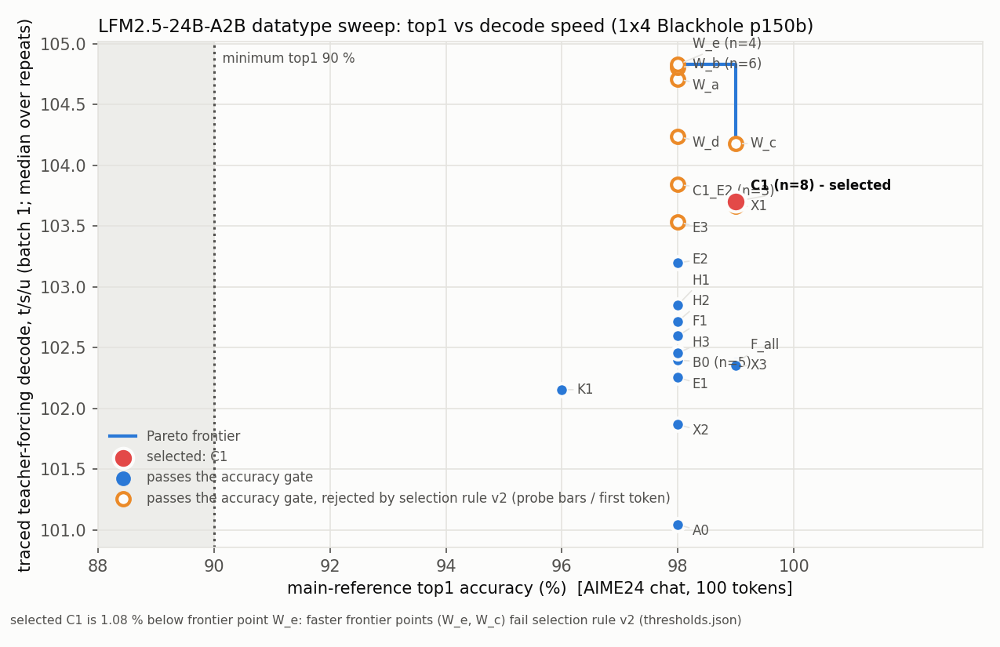
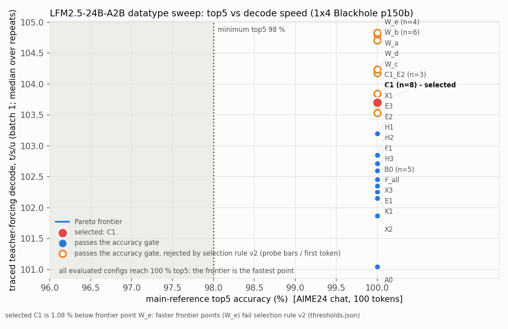

# LFM2.5-24B-A2B datatype sweep (stage 8) — 1x4 Blackhole p150b, TP = 4

## Selected config: **C1** — decode all-reduce payload BFP8, everything else as stage 7

`selected_precision_config.json` (config_id `C1`) = stage-7 `MC_POLICY` / `DEFAULT_MESH_PLAN` / BFP8 HiFi2 LM head plus
one change: `plan.ccl_dtype = "bfp8"`. The decode `all_reduce_async` payload of the attention `wo`, ShortConv `out_proj`,
dense `w2`, and MoE compact expert-sum partials (buckets <= 4) is BFP8. The all-reduce output and the residual stay bf16,
and the prefill all-reduce stays bf16. All weight dtypes, compute fidelities, the KV cache (BFP8), and the logits /
sampling path are unchanged from stage 7.

| metric | C1 (selected) | B0 (stage-7 policy, re-measured) | regime / workload |
|---|---|---|---|
| main AIME24 TF top-1 / 5 / 100 | **99 / 100 / 100 %** (99, 100, 100 of 100) | 98 / 100 / 100 % | `run_teacher_forcing`, AIME24 idx 0 chat template, 157-token prompt + 100 reference tokens |
| extended TF top-1 / 5 / 100 (400 tokens, idx 0-3) | **99.0 / 100 / 100 %** | 98.25 / 100 / 100 % | idx 1 / 2 / 3: 100 / 98 / 99 % top-1 for C1 |
| prefill top-1 / 5 / 100 | 98 / 100 / 100 % | 98 / 100 / 100 % | `run_prefill_check`, main ref |
| **traced TF decode** | **103.70 t/s/u** (median, n = 8; range 102.86-104.93) | 102.40 t/s/u (median, n = 5; 101.81-103.60) | readiness `run_teacher_forcing`: traced bucket-1 decode, token-out sampling path, per-step 128 B token readback, batch 1, trace region 768 MiB. Trace verified on every row: 99 model + 99 sampling replays, 0 eager steps, 0 captures in the window |
| TTFT, warm (sweep row) | 71.6 ms (C1 first row; 71.6-74.4 over the 8 rows) | 71.7 ms | readiness prefill of the 157-token main prompt, second request of the process |
| **post-selection token-out decode** | **107.97** t/s/u (`logs/final_selected.json`) | 106.89 t/s/u (B0 `--with-perf`, `logs/B0.json`) | readiness_driver `perf`: batch 1, prompt 128 / generate 128, greedy, warmed, no per-step readback (stage-7 harness) |
| post-selection TTFT, prompt 128 | **65.7** ms (1024/2048/4100: 97.5/135.0/295.9 ms) | 65.5 ms | same harness, request boundary synced |
| token-out b4 / b8 / b32 step | **13.63 / 19.09 / 26.10** ms | 13.75 / 19.19 / 26.20 ms | slots 0..b-1, mixed prompt lengths |
| DRAM allocated per chip | 23.22 GiB (sweep row); final 23.22 GiB | 23.22 GiB | full model + 32 x 131072 BFP8 KV, of 31.08 GiB with a 768 MiB trace region |

The post-selection values come from `logs/final_selected.json` (`perf` block), produced by the confirmation run
(`readiness_driver --runs prefill,tf,memory,qual,ar,perf`, default construction path, no `--precision`).

### Acceptance thresholds (`thresholds.json`)

- **Accuracy gate** (goal + user decision 2026-10-18): top-1 >= 90 % (skill default; the goal gives no top-1 bar),
  top-5 >= 98 %, top-100 = 100 %. The gate applies to the main ref (AIME24 idx 0, 100 tokens) **and** to the
  400-token extended aggregate (idx 0-3). The extended aggregate breaks ties. Every one of the 42 rows passes this gate.
- **Selection rule v2** (`thresholds.json` → `selection_rule_v2`; user decision 2026-10-18, after a Fable advisor
  review): choose the fastest config by median traced TF over repeat / head-to-head rows that satisfies:
  - **(a)** the accuracy gate above;
  - **(b)** the *unchanged* stage-6/7 probe suite (`tests/test_full_model.py`, 28 tests) under the trace allocation tracker;
  - **(c)** stage-7 first-token parity on the 6-prompt qualitative suite (`first_divergence > 0` on every prompt).

  Ties within 0.5 % go to the simpler config.
- **Why v2 is stricter than the goal's gate:** the goal asks only for the fastest config passing top-1/top-5, which
  would be W_e or W_b (both ≈ 104.8 t/s/u). Both break short-prompt behaviour that the 157-token AIME prompts never
  exercise. Chat prompts of <= 64 tokens prefill entirely through the decode (compact) expert copy
  (`optimized_decoder.py`: compact path at T <= 32, no dispatch copy below 96 rows), so BFP4 decode experts reach the
  first token of every short request. W_b fails 4 stage-6 probe tests (`test_prefill_lengths[1, 31, 33, 65]`) and
  changes the first generated token on 3 of 6 chat prompts. The user therefore made (b) and (c) binding.

## Pareto charts




Every evaluated row is a point (x = main-ref top-1 / top-5, y = traced TF t/s/u). The step line is the non-dominated
frontier, the red point is the selected config, and the dotted vertical line is the minimum allowed accuracy
(90 % / 98 %). Orange rings pass the accuracy gate but are rejected by selection rule v2
(`thresholds.json` `selection_rule_v2.rejected`). Generated by `tests/plot_datatype_sweep.py`, which takes the selected
id from `selected_precision_config.json`.

How to read the charts: every candidate passes the accuracy gate. Top-5 is 100 % everywhere, and top-1 sits at 98-99 %
for every row except K1 (96 %). The frontier is therefore set by speed alone: W_e (98 %, 104.83) and, on the top-1
chart, W_c (99 %, 104.18). Every row faster than C1 (W_e, W_b, W_a, W_d, W_c, C1_E2) fails rule v2 (b) or (c), or contains
a component that does. W_a was not screened directly; its rejection is inferred because it contains both C1_E2
(which fails c) and H1. C1 is 1.08 % below W_e in speed but sits at the top of the accuracy axis (99 %), and it is the
fastest config that passes (b) and (c).

## Candidate table (42 rows; repeats grouped, median TF)

Gate = main and extended top-1 >= 90, top-5 >= 98, top-100 = 100 (all pass). "Probe" = rule-v2 (b); "1st tok" = (c).
DRAM = allocated per chip incl. 32 x 131072 KV. Single runs carry ~1 % build-to-build noise (C1 range over 8 runs: 2.0 %).

| config | change vs B0 (dtype / fidelity) | n | TF t/s/u median | main t1/t5/t100 | ext t1/t5/t100 | prefill t1 | DRAM GiB | probe (b) | 1st tok (c) | decision |
|---|---|---|---|---|---|---|---|---|---|---|
| B0 | stage-7 policy: all weights BFP8 HiFi2, head BFP8 HiFi2, KV BFP8, CCL bf16 | 5 | 102.40 | 98/100/100 | 98.25/100/100 | 98 | 23.22 | pass (4/4 short) | stage 7 | baseline / escape hatch |
| **C1** | decode all-reduce payload BFP8 | 8 | **103.70** | 99/100/100 | 99.0/100/100 | 98 | 23.22 | pass (4/4 short + 3/3 bars; full tracker suite 28/28) | **pass** | **selected** |
| E1 | decode expert gate/up BFP4 HiFi2 | 1 | 102.25 | 98/100/100 | 98.25/100/100 | 98 | 21.44 | – | – | rejected: no gain (LoFi twin E2 faster) |
| E2 | E1 + expert LoFi | 1 | 103.20 | 98/100/100 | 98.5/100/100 | 98 | 21.44 | – | – | folded into C1_E2 |
| F1 | experts BFP8 LoFi | 1 | 102.60 | 98/100/100 | 98.75/100/100 | 98 | 23.22 | – | – | rejected: +0.2 % vs B0, inside noise |
| H1 | LM head BFP4 HiFi2 | 1 | 102.85 | 98/100/100 | 98.0/100/100 | 98 | 23.19 | bars pass (3/3) but prefill PCC 0.991, batch 71/72 | – | rejected: inside noise; head PCC drop |
| H2 | LM head BFP4 LoFi (twin) | 1 | 102.72 | 98/100/100 | 98.0/100/100 | 98 | 23.19 | – | – | rejected: not faster than H1 |
| H3 | LM head BFP8 LoFi | 1 | 102.46 | 98/100/100 | 98.25/100/100 | 98 | 23.22 | – | – | rejected: no gain vs HiFi2 |
| A0 | LM head bf16 (accuracy pole) | 1 | 101.04 | 98/100/100 | 98.25/100/100 | 98 | 23.28 | – | – | rejected: slower, no accuracy gain |
| W_a | C1 + E2 + H1 | 1 | 104.71 | 98/100/100 | 98.25/100/100 | 98 | 21.41 | – | – | superseded by W_b / W_e |
| F_all | all BFP8 groups LoFi (layers 0/1 conv + dense HiFi2) | 1 | 102.38 | 99/100/100 | 99.0/100/100 | 100 | 23.22 | – | – | rejected: no gain |
| X1 | ShortConv in_proj BFP4 + conv LoFi (layers 0/1 HiFi2) | 1 | 103.66 | 99/100/100 | 98.25/100/100 | 99 | 23.18 | **fail** n=65 (top-1 0.846 < 0.85) | – | rejected by (b) |
| E3 | E2 + decode expert down BFP4 | 1 | 103.54 | 98/100/100 | 98.75/100/100 | 98 | 20.55 | **fail** n=1, n=33 | – | rejected by (b) |
| X2 | attention qkv/out BFP4 LoFi | 1 | 101.87 | 98/100/100 | 96.25/100/100 | 98 | 23.21 | – | – | rejected: slower, TTFT 77.4 ms |
| X3 | dense MLP (layers 0/1) BFP4 LoFi | 1 | 102.35 | 99/100/100 | 98.5/100/100 | 98 | 23.19 | – | – | rejected: no gain |
| K1 | KV cache BFP4 | 1 | 102.16 | 96/100/100 | 93.25/99.75/100 | 96 | 18.22 | – | – | rejected: no gain, lowest accuracy |
| W_b | C1 + X1 + E3 | 6 | 104.81 | 98/100/100 | 98.5/100/100 | 99 | 20.51 | **fail** n=1/31/33/65 | **fail** (prompts 3-5) | previous provisional pick; rejected by (b)+(c) |
| W_c | C1 + X1 | 1 | 104.18 | 99/100/100 | 97.75/100/100 | 99 | 23.18 | (X1 fails) | – | rejected by (b) via X1 |
| W_d | C1 + E3 | 1 | 104.24 | 98/100/100 | 98.25/100/100 | 98 | 20.55 | (E3 fails) | – | rejected by (b) via E3 |
| W_e | W_b + H1 | 4 | 104.83 | 98/100/100 | 98.0/100/100 | 99 | 20.47 | **fail** 11/28 incl. prefill PCC < 0.99, batch | **fail** (prompts 3-5) | rejected by (b)+(c) |
| C1_E2 | C1 + E2 | 3 | 103.84 | 98/100/100 | 98.5/100/100 | 98 | 21.44 | pass (8/8 prefill lengths) | **fail** (prompts 3, 5) | rejected by (c) |

Rows per id in `sweep_results.json/.csv`: B0 = B0, B0_r2, H2H1-3_B0; C1 = C1, C1_r2, C1_r3, H2H1-5_C1;
W_b = W_b, H2H1-5_W_b; W_e = W_e, H2H1-3_W_e; C1_E2 = C1_E2, H2H4-5_C1_E2. H2H rows were run interleaved in one
session in a fixed (not alternating) order every round (rounds 1-3: B0 / C1 / W_b / W_e; rounds 4-5: C1_E2 / W_b / C1).

C1 vs B0, taking the noise into account: medians over all rows give +1.27 %. Over the interleaved rounds 1-3 only, the
medians are 103.06 vs 102.49 (+0.56 %), with C1 faster in 2 of 3 rounds. The C1 gain is real but small, about the same
size as the build-to-build noise. C1_E2 vs C1 is +0.14 %, inside the noise.

## Per-material-matmul-group decisions

TF = single-row or median t/s/u (B0 reference 102.40). Accuracy = main top-1 / ext top-1 (top-5 = 100 % everywhere
except K1 ext 99.75 %).

| group | dtype | fidelity | row | TF | accuracy | kept? | reason |
|---|---|---|---|---|---|---|---|
| decode all-reduce payload (CCL) | bf16 | – | B0 | 102.40 | 98 / 98.25 | – | baseline |
| | **BFP8** | – | C1 | **103.70** | 99 / 99.0 | **kept** | fastest single change passing (a)-(c) |
| expert gate/up (decode copy) | BFP8 | HiFi2 | B0 | 102.40 | 98 / 98.25 | **kept** | |
| | BFP8 | LoFi | F1 | 102.60 | 98 / 98.75 | rejected | inside noise |
| | BFP4 | HiFi2 | E1 | 102.25 | 98 / 98.25 | rejected | no gain |
| | BFP4 | LoFi | E2 / C1_E2 | 103.20 / 103.84 | 98 / 98.5 | rejected | C1_E2 fails (c); +0.14 % over C1 |
| expert down (decode copy) | BFP8 | HiFi2 | B0 | | | **kept** | |
| | BFP4 | LoFi | E3 (+E2) | 103.54 | 98 / 98.75 | rejected | fails (b) n=1, n=33. No BFP4 HiFi2 twin was run; the BFP4+LoFi requirement is met |
| expert prefill dispatch copy | BFP8 | HiFi2 | all | | | **kept** | not swept to BFP4 (prefill-only cost; the decode copy is separate) |
| ShortConv in_proj | BFP8 | HiFi2 | B0 | | | **kept** | |
| | BFP8 | LoFi | F_all (with all groups) | 102.38 | 99 / 99.0 | rejected | no gain |
| | BFP4 | LoFi (layers 0/1 HiFi2) | X1 | 103.66 | 99 / 98.25 | rejected | fails (b) n=65. No BFP4 HiFi2 twin; BFP4+LoFi run |
| ShortConv out_proj | BFP8 | HiFi2 | B0 | | | **kept** | BFP4 failed in stage 3 (plan §3), not re-swept |
| attention qkv / wo | BFP8 | HiFi2 | B0 | | | **kept** | |
| | BFP8 | LoFi | F_all | 102.38 | 99 / 99.0 | rejected | no gain |
| | BFP4 | LoFi | X2 | 101.87 | 98 / 96.25 | rejected | slower (prefill TTFT 77.4 ms), ext top-1 lowest of the weight candidates |
| dense MLP w13 / w2 (layers 0, 1) | BFP8 | HiFi2 | B0 | | | **kept** | |
| | BFP8 | LoFi | F_all | 102.38 | | rejected | no gain |
| | BFP4 | LoFi | X3 | 102.35 | 99 / 98.5 | rejected | no gain (2 layers) |
| LM head | BFP8 | HiFi2 | B0 | | | **kept** | |
| | BFP8 | LoFi | H3 | 102.46 | 98 / 98.25 | rejected | no gain |
| | BFP4 | HiFi2 | H1 | 102.85 | 98 / 98.0 | rejected | inside noise; prefill PCC 0.991 |
| | BFP4 | LoFi | H2 | 102.72 | 98 / 98.0 | rejected | not faster than H1 |
| | bf16 | HiFi2 | A0 | 101.04 | 98 / 98.25 | rejected | slower, no accuracy gain |
| KV cache | BFP8 | – | B0 | | | **kept** | |
| | BFP4 | – | K1 | 102.16 | 96 / 93.25 | rejected | no speed gain; lowest accuracy. bf16 KV does not fit at 32 x 131072 (33.9 > 31.08 GiB/chip, plan §0) |
| router / routing weights | bf16 (fp32 acc) | – | all | | | **kept** | excluded from the BFP4 sweep (skill: routing numerics are sensitive) |

Every BFP4 group that was tried has a BFP4+LoFi row (E2/E3, X1, X2, X3, H2). BFP8 LoFi vs HiFi2 was compared on the
dominant decode groups (F1 for experts, F_all for all groups, H3 for the head); LoFi gave no measurable gain anywhere.

## Qualitative suite (rule-v2 criterion c)

Prompts: the shared 6-prompt chat-template suite (`qualitative_*/prompts.json`, `qualitative_prompt_format.json`),
128 greedy tokens, compared with the HF greedy continuation. `first_divergence` = index of the first token where TT ≠ HF.

| prompt | 0 haiku | 1 supervised vs unsup. | 2 story | 3 thermodynamics | 4 translate | 5 fibonacci |
|---|---|---|---|---|---|---|
| stage 7 (= B0) | 27 | 5 | 102 | 57 | 68 | 21 |
| **C1** (`logs/qual_C1.log`, `qualitative_C1/`) | **27** | **5** | **102** | **57** | **38** | **21** |
| C1_E2 (`logs/qual_C1_E2.log`) | 26 | 5 | 39 | **0** | 83 | **0** |
| W_b / W_e (`qualitative_W_b/`, `qualitative_W_e/`) | 26 | 5 | 83 | **0** | **0** | **0** |
| selected config, final confirmation run (`qualitative/`, `logs/final_selected.log`) | 27 | 5 | 102 | 57 | 38 | 21 |

HF first-token control (`logs/qual_first_token_control.log`, `repro/qual_first_token_control.py`): the first tokens
that flip are near-ties in HF. Prompt 3: HF '1' 0.555 vs 'The' 0.297. Prompt 4: 'The' 0.600 vs '1' 0.364. Prompt 5:
'\n' 0.413 vs 'The' 0.365. Prompt 1 is also a near-tie ('\n' 0.429 vs 'We' 0.378) but is preserved by every config. The
W_b/W_e flips pick the HF runner-up, so the output stays plausible. Even so, the first token is different on half the
prompts, which (c) excludes. C1 keeps stage 7's tokens through 5-102 positions. Its only change is prompt 4 diverging
at 38 instead of 68.

## Context contract, KV and non-aligned prompts

- The KV cache stays BFP8 (layout `[blocks, 2 local kv heads, 64, 64]` per chip, block 64, bf16 update input), so the
  capacity is unchanged: 131072 tokens x 32 users. The trace region (768 MiB) and prefill chunking are also
  unchanged. `doc/context_contract.json` gets a `datatype_sweep` block (filled from
  `final_selected.json` memory: 23.22 of 31.08 GiB allocated per chip, 32 x 131072 KV). K1 (BFP4 KV) would have freed DRAM (18.22 GiB) but was rejected.
- Non-aligned prompts: C1 changes no KV dtype, layout, trace buffer or chunking. It does change the decode all-reduce,
  which 32-row prefill chunks also use, so prompts of <= 32 tokens are affected. Covered by:
  - `test_prefill_lengths[1, 31, 33, 65]` (`logs/probe_short_C1.log`, 4 passed, PCC 0.998-0.999);
  - `[300, 4100]` + batch (`logs/probe_bars_C1.log`, 3 passed);
  - the full `[1, 31, 33, 65, 77, 300, 2047, 2049, 4100]` set in the final tracker suite
    (`logs/test_full_model_tracker_selected.log`: all 9 prefill lengths pass; suite 28 passed under `TT_METAL_TRACE_ALLOC_TRACKING=1`).

## Propagation: the selected policy is what runs

- `tt/precision.py::resolve()` is the single entry point: `LFM2_PRECISION_CONFIG` (a path or `baseline`) →
  `doc/datatype_sweep/selected_precision_config.json` → baseline. `Lfm2Model` and `build_generator` call it by
  default. Per-layer policy comes from `layer_exceptions`, and the weight-cache key includes the weight signature and
  the precision.
- `tests/test_precision_config.py`:
  - `test_default_path_consumes_selected_config` checks each group's device tensor dtype, the compute-kernel
    fidelities, the layer exceptions, the head and the CCL dtype on the default path;
  - `test_baseline_escape_hatch` checks `LFM2_PRECISION_CONFIG=baseline`.

  Log: `logs/test_precision_config.log` (2 passed).
- `repro/check_perf_rows.py`: the reduced-probe Tracy `decode_perf_report.csv` (default path) is checked against the
  selected JSON. It covers the weight dtype (`Input 1 Datatype`) and `Math Fidelity` of the dominant decode matmuls
  and the AllReduceAsync payload dtype. Output: `perf/perf_rows_check.json` (`all_ok: true`: LM head, expert gate/up + down, attention qkv, ShortConv in_proj, dense w13 all BFLOAT8_B/HiFi2; 30 AllReduceAsync rows with BFLOAT8_B payload). The W_b version
  (`perf/perf_rows_check_W_b.json`, all ok, incl. BFP4/LoFi expert rows) shows the check does catch non-default
  dtypes.
- vLLM: the adapter (`tt/generator_vllm.py`) does not exist until stage 9. It must construct the model through the
  same `build_generator` / `resolve()` path, so the policy is inherited without a separate copy. Stage 9 has to
  re-prove this.
- Return to the baseline with `LFM2_PRECISION_CONFIG=baseline` (stage-7 policy, bf16 CCL), or point the variable at
  any `configs/<id>.json`.

## Limitations

- The speed gains are small. The model is bound by op count and dispatch, not weight bandwidth, so lower-precision
  weights barely move decode. The best candidate overall (W_e) is +2.4 % over B0, and the selected C1 is +1.3 %
  (median over all rows) or +0.56 % (interleaved rounds).
- Single-row candidates (n = 1) are ranked against ~1 % build-to-build noise. Only B0, C1, C1_E2, W_b and W_e have
  repeats.
- Two candidates from the advisor's list were not run: C1_E2_x (experts of layers 2 / 39 at BFP8) and C1_E3_x. Their
  configs exist in `configs/`. C1_E2 is only +0.14 % over C1, so even a fully recovered C1_E2_x could not clear the
  0.5 % tie band (advisor stop rule).
- No BFP4+HiFi2 twins for expert down (E3) and conv in_proj (X1). Both groups were rejected by (b) with LoFi.
- Rule (c) is binary and sensitive to HF near-ties. It is a user policy choice; it is stricter than the goal's gate.
- The 3-layer probe smokes run before the sweep (`logs/probe_smoke_ccl_only.log`: 7 passed; `probe_smoke_rest.log` /
  `probe_risky_smoke.log`: 3 failed probe-accuracy assertions each, for the non-CCL risky knobs) used configs from a
  scratchpad that was not kept. Only their logs remain; they served as plumbing smokes and are not selection evidence.
- Experts keep two resident weight copies (stacked decode copy + per-expert prefill dispatch copy), both BFP8/HiFi2 under C1;
  `selected_precision_config.json` lists them as four `expert_*_{decode,prefill}` groups. Stage 9/10 DRAM budgets must
  count both.
- `logs/qual_first_token_control.log` labels its TT column "stage8"; that run was W_b (05:19), not C1. It is used only
  as the HF near-tie control.
- Rule (b) screens of rejected candidates ran the reduced 3-layer probe (`logs/probe_*.log`); only C1 ran the full
  28-test tracker suite. W_a was never screened; its rejection is inferred (contains C1_E2, which fails (c)).
- For stage 9: the shared-generator key in `tt/generator.py` uses the explicit `precision` argument, not the resolved
  `LFM2_PRECISION_CONFIG` / selected file, so changing that env var between builds on one open mesh reuses the old
  generator. `Lfm2Model(policy=...)` without `plan=` keeps the selected plan (`ccl_dtype=bfp8`). The weight-cache key
  includes the whole plan, so `ccl_dtype` (no weight bytes change) forks a separate ~54 GB cache directory.
- The `policy` / `plan` blocks in `selected_precision_config.json` are descriptive snapshots; only `*_overrides`,
  `layer_exceptions` and `head` are consumed. `repro/check_perf_rows.py` reads the snapshot, so it must be regenerated
  if `MC_POLICY` / `DEFAULT_MESH_PLAN` change in a later stage.

## Commands

```bash
source session_state/env.sh            # tt-metal venv, TT_METAL_HOME, PYTHONPATH, M=models/autoports/liquidai_lfm2_5_24b_a2b
# extended references (AIME24 idx 1-3, 100 tokens each): logs/ref_gen_p{1,2,3}.log
# sweep (parent spawns one child process per config, appends to sweep_results.json/.csv)
python -m models.autoports.liquidai_lfm2_5_24b_a2b.tests.datatype_sweep --only B0,E1,...      # [--perf B0]
python -m models.autoports.liquidai_lfm2_5_24b_a2b.tests.datatype_sweep --run-one $M/doc/datatype_sweep/configs/C1.json --json $M/doc/datatype_sweep/logs/C1.json
# qualitative suite for one config
LFM2_QUAL_OUT=$PWD/$M/doc/datatype_sweep/qualitative_C1 python -m models.autoports.liquidai_lfm2_5_24b_a2b.tests.readiness_driver \
    --precision $PWD/$M/doc/datatype_sweep/configs/C1.json --runs qual --json $M/doc/datatype_sweep/logs/qual_C1.json
# probe screens: pytest $M/tests/test_full_model.py -k "prefill_lengths" with LFM2_PRECISION_CONFIG=<configs/X.json>
# confirmation chain for the selected (default-path) config: session_state/scratchpad_tools/stage8_confirm.sh
#   test_precision_config -> readiness_driver --runs prefill,tf,memory,qual,ar,perf -> tracker suite
#   -> Tracy probe + repro/check_perf_rows.py -> test_weight_cache
python $M/tests/plot_datatype_sweep.py          # Pareto PNGs (selected id from selected_precision_config.json)
```

Hardware: QuietBox 4x Blackhole p150b, mesh 1x4 FABRIC_1D_RING, router payload 8192 B, l1_small 24576, trace region
768 MiB. Sweep rows were produced at commit 1185eabe with the uncommitted stage-8 worktree (`worktree_tt_md5` per row).

## Artifacts

| path | content |
|---|---|
| `selected_precision_config.json` | selected C1: policy, plan, layer exceptions, head, weight groups, activations, CCL, KV, logits/sampling, runtime flags, accuracy, performance, selection provenance |
| `selected_precision_config_W_b.json` | superseded provisional W_b selection |
| `thresholds.json` | gate, tie band, `selection_rule_v2` |
| `sweep_results.json` / `.csv` | 42 rows: dtype + fidelity policy, accuracy, TTFT, traced TF, trace verification, command, commit, hardware, mesh |
| `configs/*.json`, `configs/matrix.json` | per-candidate precision configs (incl. unrun C1_E2_x, C1_E3_x) |
| `logs/<id>.json/.log` | per-row child results and logs |
| `logs/probe_short_*.log`, `probe_bars_*.log`, `probe_screen_C1_E2.log` | rule-v2 (b) probe screens |
| `logs/qual_C1*.json/.log`, `qualitative_C1*/`, `qualitative_W_b/`, `qualitative_W_e/` | rule-v2 (c) qualitative runs |
| `logs/qual_first_token_control*.log`, `repro/qual_first_token_control.py` | HF first-token near-tie control |
| `logs/final_selected.json/.log`, `logs/test_*_selected.log`, `logs/tracy_probe_selected.out`, `perf/tracy_probe_selected/`, `perf/perf_rows_check.json`, `qualitative/` | C1 confirmation (all steps exit 0; weight-cache test 1 passed) |
| `*_W_b.*`, `*_W_e.*` (logs/, perf/, qualitative_*) | superseded confirmation evidence of W_b and W_e |
| `top1_perf_pareto.png`, `top5_perf_pareto.png` | Pareto charts |
| `work_log.md` | chronological log |
